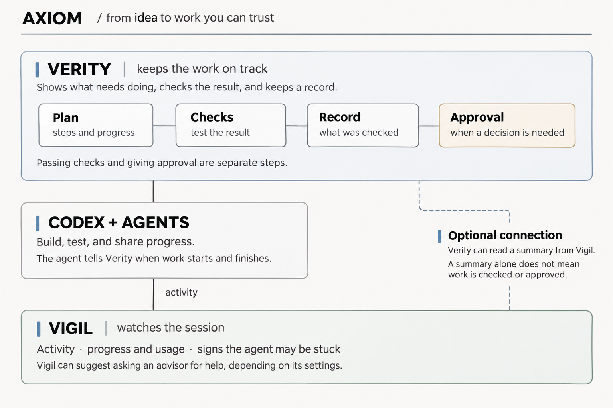

# Axiom

Axiom contains two independent Go modules. Verity owns workflows, approval,
verification and proof; Vigil observes Codex hooks, budgets and advisor signals.
The optional Verity-owned MCP client reads Vigil snapshots and records explicit
links; a hook or link is not evidence of workflow completion or approval.
See [Verity](verity/README.md), [Vigil](vigil/README.md), and the
[synthetic bridge example](verity/docs/integrations/local-example.md).



## Quick install from source

Obtain the source with both `vigil/` and `verity/` in the workspace.
To build both tools, you
need Go 1.26.5 or newer, CGO enabled, and a working C compiler. On macOS,
install the Xcode Command Line Tools with `xcode-select --install`. Codex is
needed for Vigil's integration.

From the workspace directory:

```sh
cd vigil
go build -o ./vigil ./cmd/vigil
./vigil install
```

In Codex, review and trust the hooks using `/hooks` in the CLI or **Settings
→ Hooks** in the desktop app, then open a new session. Keep the Vigil binary
at its installed path. After a short Codex turn, run `./vigil status` and
`./vigil history --last 20` from the `vigil/` directory.

Install Verity from the workspace and initialize a project:

```sh
cd ../verity
go install ./cmd/verity
verity version
verity init /path/to/project
verity doctor /path/to/project/.verity/config.yaml
```

If `verity` is not found, add Go's binary directory to your `PATH`; see the
[Verity install instructions](verity/README.md#install) for the steps. Verity
is initialized separately for each project. Its verification checks require
project-specific configuration and tools; see the linked README for details.
For custom Vigil configuration and removal, see the [Vigil README](vigil/README.md).

## Development

Use Go 1.26.5 or newer (Vigil's `go.mod`; Verity requires 1.23), CGO enabled,
a working C compiler for SQLite, Python 3, and make. Run from this directory:

```sh
make check          # both full Go suites and the Python tracker
make check-verity   # Verity Go suite and tracker
make check-vigil    # Vigil Go suite
```

Each Go command runs in its module directory (`go -C`). For a focused test,
use the module's directory and `go test ./internal/...` with the relevant
package; see the AGENTS files for concrete routes. If the default build cache
is not writable, use a private writable directory, for example:

```sh
mkdir -p /tmp/axiom-go-cache
GOCACHE=/tmp/axiom-go-cache make check
```

Go module dependencies must already be cached or downloadable. Verity's
verification runner sets a temporary HOME and does not pass the caller's Go
cache variables, so it starts with an empty default module cache and needs
network access to the Go module proxy (and toolchain downloads if needed).
A warm interactive cache alone does not make that runner offline-capable.
See [AGENTS.md](AGENTS.md) for the exact snapshot selection and workflow.
The root CI workflow checks both modules. This local copy has no Git metadata;
publication is planned as a single repository.

## Preparing a public release

See [publication preparation](PUBLICATION.md) before copying or publishing
files. Local experiment records require separate privacy and rights review.

## License

Axiom is available under the [MIT License](LICENSE). Third-party material must
be reviewed separately before inclusion in a release.
