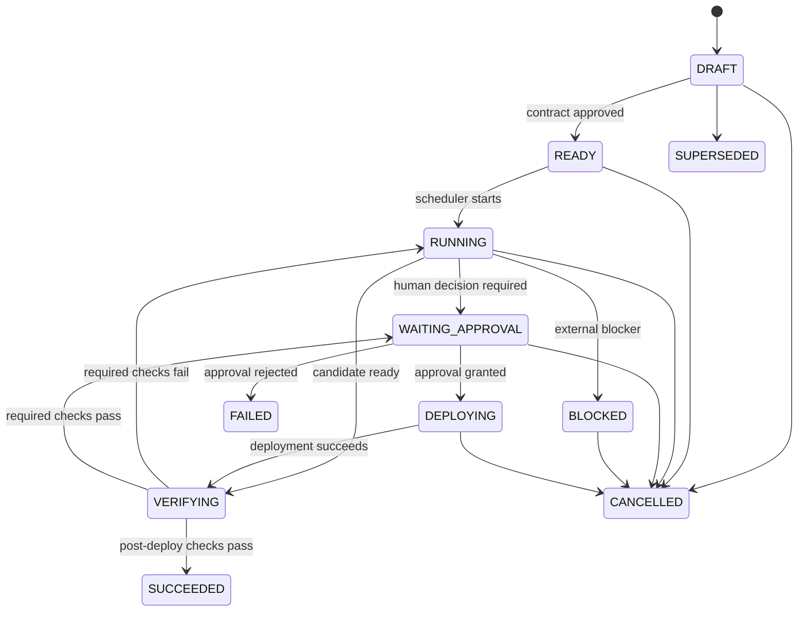
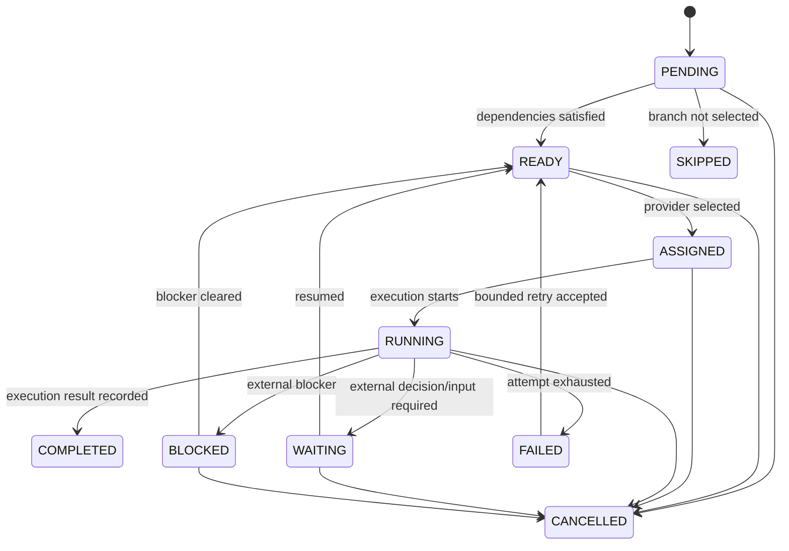

# Verity architecture (initial)

Verity is a Go module rooted at this directory. The three product layers
live under `internal/` and have distinct ownership:

- `internal/process`: project/workflow lifecycle, task scheduling and
  policy-controlled orchestration. Its workflow state machine is the
  authority for lifecycle state.
- `internal/verification`: candidate-bound check plans and observations.
  A check result is evidence input; it does not itself authorize a gate.
- `internal/proof`: provenance, integrity metadata and proof bundle
  assembly. Artifact bytes belong in an artifact store, not in records.

SQLite persistence lives in `internal/store/sqlite`; domain packages remain
independent of SQLite and do not invoke shell commands, agents, databases,
or deployment providers. The CLI is implemented in `cmd/verity`, with YAML
configuration and JSON structured logging/correlation IDs under `internal/`.

Phase 2 adds `internal/process/control`, a deterministic run-level model
with versioned immutable definition snapshots, task DAG validation,
dependency scheduling, approval nodes, bounded retries and transition
budgets. SQLite stores definition versions, run snapshots and expiring
scheduler leases. Scheduling exposes eligible tasks only; no agent or
repository command is invoked. Workflow run inspection is available through
`workflow list/show`, and task inspection through `task list`.
`RunWithActivities` provides a bounded deterministic fake-activity driver for
tests and demos; approval outcomes are supplied explicitly through its
activity interface.

Phase 3 adds `internal/execution` provider contracts and bounded runtime
invocation, with deterministic fake and manual handoff implementations.
`internal/execution/workspace` isolates work in detached Git worktrees and
refuses cleanup unless a Verity ownership marker is present and the
worktree is clean. Execution attempts retain their base and candidate SHAs;
their completion does not complete a Process Control task or pass
Verification. Phase 10 persists invocation intent before runtime calls, records immutable attempt events in SQLite, and recovers interrupted attempts as UNKNOWN pending explicit reconciliation.

Phase 4 adds versioned verification manifests and deterministic plans,
command and Playwright check adapters, and a bounded runner. The runner
materializes a full Git revision into a disposable source snapshot, invokes
argv directly without shell interpolation, applies per-check timeouts and
output limits, and uses a restricted environment. A displayed plan requires
explicit approval before checks run. Aggregate decisions include PASS, FAIL,
BLOCKED, NEEDS_HUMAN, STALE, PARTIAL and CANCELLED; only required passing
checks with complete acceptance-criteria coverage can pass. Review output is
advisory until a human decision is recorded. Verification runs are not yet
persisted and check output is not yet stored in Proof.

Phase 5 adds a content-addressed local artifact store, SHA-256 checked on
write and read; evidence provenance records; SQLite persistence for evidence,
verification runs and append-only proof audit events; helpers that attach
required check output evidence before a verification run is stored; and
candidate-bound reproducible JSON proof bundles. The CLI exposes `proof
show` and `proof export`. Retention/redaction policy primitives are explicit
and opt-in; no artifact is automatically expired or redacted.

## Initial state flow

The initial transition contract remains pure. Phase 1 persists accepted
transitions transactionally alongside append-only workflow events. The
database uses a versioned migration ledger and foreign keys.

## Trust boundaries

Repository contents, task descriptions, runtime output, check output and
integration callbacks are untrusted inputs. Verification commands run only
after the manifest plan is explicitly approved, as argv without a shell, in
a disposable source snapshot bound to a full commit SHA. Per-check time and
captured output are bounded, and the runner does not inherit the caller's
environment except PATH/locale values. This is process-level containment,
not an OS sandbox; repository commands can still access resources available
to the Verity process. Secrets must not enter workflow contracts, logs,
evidence metadata or proof bundles. Workflow and evidence records bind to a
full commit SHA or content digest.

## Deployment and persistence decisions

The initial target is a local, single-node executable. A self-hosted team
service remains a later deployment mode. SQLite is the local source of
truth; PostgreSQL is deferred until concurrent team access is a concrete
requirement. Both support transactional state changes and append-only
workflow events, but PostgreSQL adds operational deployment and connection
management that the single-node MVP does not need.

The MVP uses a persisted deterministic Go state machine and one scheduler
process. Temporal adds durable timers, distributed workers and replay
semantics, but also requires operating a workflow service and constrains
workflow code to deterministic replay. Current MVP needs do not justify
that cost. The domain remains independent of the engine choice.

Use a local filesystem artifact store first. Store application-managed
artifact references plus content digests in the database. Keep a future
S3-compatible backend behind an adapter; never persist credentials in
workflow or proof records.

## Minimum user surface

The initial CLI surface is `verity init`, `verity doctor`,
`verity config validate`, and read-only project/workflow inspection.
`init` creates local configuration and storage only after explicit user
action; `doctor` reports environment and database readiness; config
validation never runs repository commands. Defer HTTP API and dashboard
until domain contracts stabilize. Future HTTP routes are versioned under
`/api/v1` and use the same application service as the CLI.

## Execution boundary

Verification manifest commands are untrusted input and are exposed in a
candidate-pinned plan for review before execution. The runner uses argv
(never shell interpolation), an isolated temporary source snapshot, bounded
time/output, cancellation and a restricted environment. It does not inherit
secrets by default. Git operations use a separate adapter; destructive
cleanup must verify Verity ownership and a clean worktree.

## Task state flow

`COMPLETED` means the execution unit finished; acceptance remains a
workflow-level verification decision.

## Phase 6 lifecycle

`internal/lifecycle` composes candidate implementation with candidate-pinned
Verification, independent review, a preview adapter that must report the
verified source SHA, preview smoke evidence, optional post-deploy verification,
human release approval, and candidate-bound Proof assembly. Correction attempts
have an explicit maximum. Required check output and preview smoke output are
captured as content-addressed evidence. No production deployment adapter is
available; requesting production deployment fails closed.

## Phase 7 integrations

`internal/integrations/github` verifies and normalizes selected webhook events,
deduplicates delivery IDs through SQLite, publishes SHA-pinned Check Runs and
an updatable PR summary, and lists/downloads GitHub Actions runs and artifacts.
The application supplies an event handler so provider callbacks remain outside
the domain state machine. SQLite stores delivery claims and idempotent
pull-request/workflow associations keyed by repository, PR number, and head
SHA. Each new head SHA gets its own association and cannot reuse the prior
candidate's verification record.

`internal/integrations/preview` defines provider-neutral URL/deployment
contracts and a Netlify build adapter that verifies the deployment's reported
source SHA. Integration credentials are injected at runtime. GitHub HTTP
requests have bounded retries, cancellation, pagination, and explicit
permission/rate-limit errors; webhook bodies and artifact downloads are
bounded. Workflow creation and verification invalidation are delegated to the
application event handler, which receives the normalized new SHA.

## Phase 10 durable execution attempts

`internal/execution.RunDurable` asks the runtime for capabilities, commits the
request/provider intent, then invokes the provider and appends its observed
result. A provider error with no authoritative result becomes UNKNOWN. SQLite
stores an immutable request record plus append-only lifecycle events; schema
migration 6 adds these tables and uniqueness constraints. Startup recovery
appends UNKNOWN for attempts whose latest state is RUNNING. UNKNOWN attempts
require explicit reconciliation or abandonment before their task attempt number
can be reused. Reconciliation records actor, reason, optional evidence reference,
and execution outcome only. It does not assert a Vigil session association,
verification result, or workflow acceptance.
